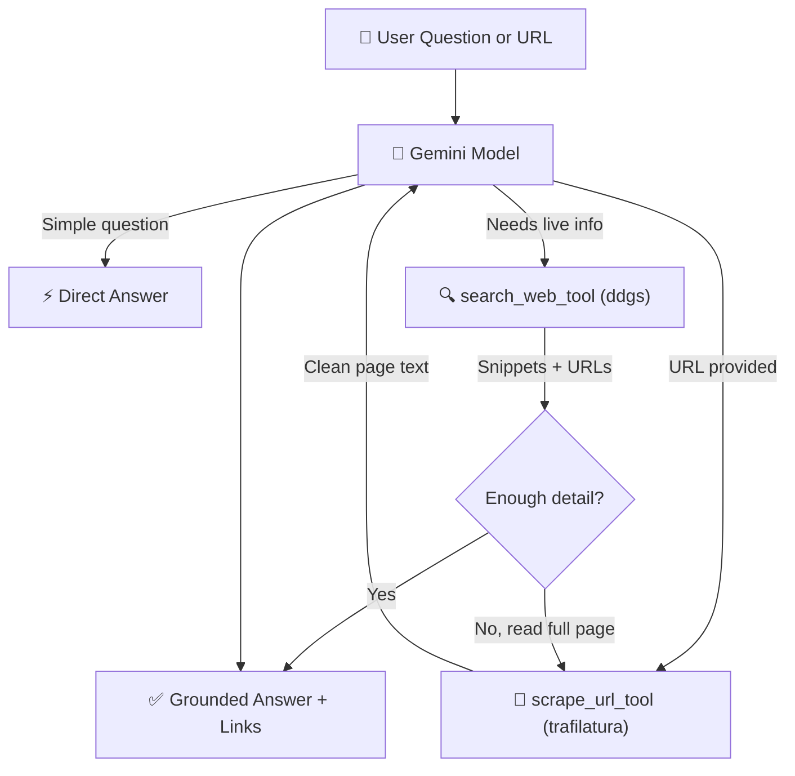

# 🌐 Wassup AI

**Web Agent Search, Scrape & Understand Pages**

Wassup AI is a fast, friendly AI assistant that doesn't just rely on static memory—it searches the live web, reads full web pages, and gives you clear, source-cited answers.

🚀 **Live Demo:** [https://wassupai.streamlit.app/](https://wassupai.streamlit.app/)

---

## ✨ Key Features

* **🧠 Smart Tool Decisions:** Answers simple greetings and general questions right away, and only searches or scrapes the web when fresh facts are needed.
* **🔍 Live Web & News Search (`ddgs`):** Automatically picks between general web search and live news search (with date filters) and skips empty landing pages.
* **📄 Deep Page Reading (`trafilatura`):** Reads full articles, blog posts, or documentation pages—stripping away ads and menus—when you paste a URL or when search snippets aren't enough.
* **🔗 Multi-Hop RAG Loop:** Runs an iterative manual tool loop (up to 4 tool turns) so Gemini can **search** for links, **scrape** the best page, and feed the extracted text back to write a grounded answer.
* **💬 Transparent Chat UI:** Built with Streamlit to show you each search and scrape step live, plus an expandable view of the exact web content used.

---

## 🛠️ Tech Stack

* **Language:** Python
* **AI & SDK:** Google GenAI SDK & Gemini API
* **Web Search:** `ddgs` (Dux Distributed Global Search)
* **Web Scraping:** `trafilatura`
* **Interface:** Streamlit

---

## ⚙️ How It Works

Instead of searching blindly on every message, Wassup AI acts as a smart router in a multi-turn loop:



---

## 🚀 Run Locally

1. **Add your Gemini API key** to a `.env` file in the project root:
   ```env
   GEMINI_API_KEY="your-gemini-api-key"
   ```
2. **Start the Streamlit app:**
   ```bash
   streamlit run backend/streamlit/stream_app.py
   ```
   *(Or try the terminal chat with `python backend/app/services/gemini.py`.)*

---

## 📄 License

This project is licensed under the **Apache License 2.0** — see the [LICENSE](LICENSE) file for details.
