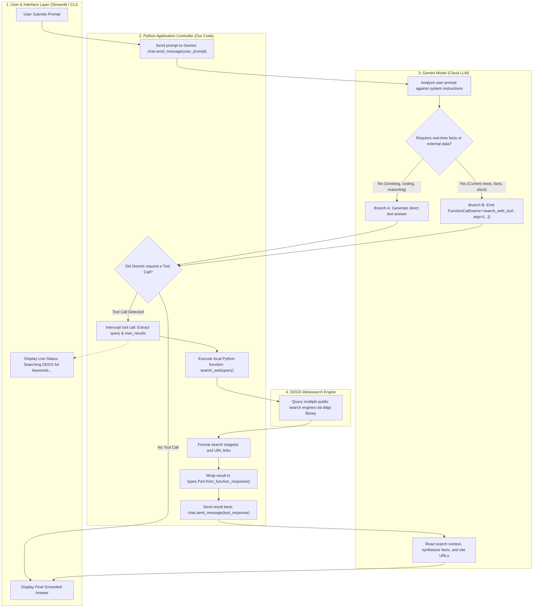
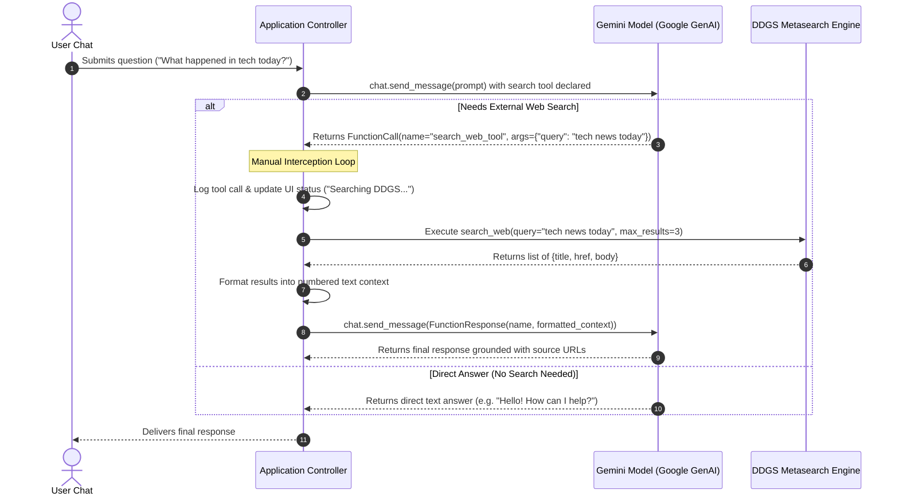

# Implementation Plan: Manual Tool Calling for DDGS Metasearch

> Document Target: `.agents/implement_plan/manual-tool-calling-ddgs.md`  
> Objective: Transition from eager, hardcoded search to LLM-governed manual tool execution using DDGS (Dux Distributed Global Search) and Google GenAI SDK (`google-genai`).

---

## 1. Executive Summary & Goal

In **Phase 1**, the application executed a search on every prompt before the model had an opportunity to evaluate the user request. In **Phase 1.5**, we transition to **Autonomous Function / Tool Calling**.

### Primary Goals:
1. **Model Autonomy**: Allow Gemini to decide whether a user query requires external search or can be answered directly (e.g., greetings, logic, coding).
2. **Intelligent Query Formulation**: Let Gemini formulate concise search queries instead of sending conversational user questions directly to the search engine.
3. **Manual Tool Execution (Pedagogical Choice)**: Intercept tool calls manually in code rather than letting the SDK auto-resolve them. This provides transparency, allows step-by-step logging, and updates Streamlit status boxes in real time.
4. **Source Link Extraction**: Enable the model to consume structured DDGS snippets and URLs to cite verified source links.

---

## 2. Architecture Comparison

### 2.1 Current Architecture (Phase 1: Eager Search RAG)

Every prompt automatically triggers a DDGS metasearch call, regardless of intent.

```text
+-------------------------------------------------------------------------------+
|                       PHASE 1: EAGER SEARCH PIPELINE                          |
+-------------------------------------------------------------------------------+

  [User Input]
       │
       ▼
  [search_web(prompt)]  <-- Always runs DDGS metasearch first
       │
       ▼
  [format_search_results()]
       │
       ▼
  [augmented_prompt()]  <-- Injects raw search text into prompt string
       │
       ▼
  [Gemini Model]        <-- Receives combined context + question
       │
       ▼
  [Final Answer]
```

#### Limitations of Phase 1:
- Unnecessary latency (~1-3 seconds) on simple greetings or non-search tasks.
- Noisy queries: conversational phrases (e.g., *"Can you please explain..."*) degrade search engine accuracy.
- Rigid pipeline: cannot support multi-step tool calls or url scrapers later.

---

### 2.2 New Architecture (Phase 1.5: Manual Tool Calling Loop)

#### The Core Mental Model: Who Does What?
A common misconception is thinking the LLM connects to the internet directly. It does not:
1. **Gemini** runs in the cloud. It only has language intelligence and reasoning. It cannot execute Python code or access local network sockets.
2. **Our Python Application** controls the execution environment. It runs locally, imports `ddgs`, and controls the chat session.
3. In **Manual Tool Execution**, Gemini issues a structured request asking our Python app to run a search. Our Python app runs the search locally, sends the search data back to Gemini, and Gemini crafts the final answer.

Because our Python code sends messages to Gemini **twice** in a single turn (first the user prompt, then the search results), this process is called a **Two-Turn Tool Loop**.

---

#### Architecture Diagram (Entity & Component Separation)



---

#### Step-by-Step Breakdown of the Loop

```text
Turn 1: Decision Phase
  [User] ──("Who won the match?")──> [Python Controller] ──> [Gemini]
                                                                 │
                                                       (Needs facts? YES)
                                                                 │
  [Python Controller] <─── FunctionCall(query="match winner") ───┘

Execution Phase (Local to Python)
  [Python Controller] ──> runs search_web(query) ──> [DDGS Metasearch]
                                                            │
  [Python Controller] <── {title, href, snippet} <──────────┘

Turn 2: Grounding & Delivery Phase
  [Python Controller] ─── FunctionResponse(context) ─────────> [Gemini]
                                                                 │
                                                       (Synthesizes facts)
                                                                 │
  [User] <── "Australia won..." citing URLs <── [Python] <───────┘
```

1. **Turn 1 (Prompt & Decision)**:
   - The user asks a question.
   - The Python controller sends the prompt to Gemini with `search_web_tool` declared in the session config.
   - **Branch A (Direct Answer)**: If the prompt is *"Hello"* or a standard Python question, Gemini responds with text. `response.function_calls` is empty. The answer is printed immediately.
   - **Branch B (Tool Needed)**: If the prompt asks for real-time facts, Gemini does **not** answer yet. Instead, it returns `response.function_calls = [FunctionCall(name="search_web_tool", args={"query": ...})]`.
2. **Local Interception (The "Manual" Step)**:
   - Because `automatic_function_calling` is disabled, the Python controller intercepts the function call.
   - The Python controller reads the AI-generated query (e.g. `query="latest match score"`).
   - In Streamlit, it triggers `st.status("Searching DDGS for: latest match score...")`.
   - It invokes our local `search_web()` function, which queries the DDGS metasearch library and gets titles, snippets, and source URLs.
3. **Turn 2 (Grounding & Synthesis)**:
   - The Python controller packages the search results into `types.Part.from_function_response(...)`.
   - It sends this package back to the same `chat` session via `chat.send_message(...)`.
   - Gemini receives the tool response, reads the facts and URLs, and produces the final grounded answer.
   - The final answer is displayed to the user with full source links.

---

### 2.3 Interaction Sequence (Mermaid Diagram)



---

## 3. Manual Tool Execution vs. Automatic Function Calling (AFC)

The `google-genai` SDK supports two modes for function calling:

| Feature | Manual Tool Execution (Chosen) | Automatic Function Calling (AFC) |
| :--- | :--- | :--- |
| **How It Works** | App catches `response.function_calls`, runs the function in local code, and sends `FunctionResponse` back. | The SDK automatically calls the local Python function and sends the response back internally. |
| **Control & Visibility** | Full control. Developer can log arguments, intercept network failures, and display step-by-step UI spinners in Streamlit. | Black-box execution inside SDK turn. Difficult to intercept before execution completes. |
| **Learning Value** | High. Developer learns the exact JSON-RPC / tool-call protocol used by modern LLM agents. | Low. Masks the underlying tool exchange mechanism. |
| **Streamlit Fit** | Excellent. Can trigger `st.status("Searching DDGS...")` precisely when the tool call arrives. | Requires custom wrapper or post-call history parsing. |

---

## 4. Architectural Components & Changes

### 4.1 Lookup Table of Affected Files

| Component / File | Current Role | Phase 1.5 Responsibility |
| :--- | :--- | :--- |
| `backend/app/services/web_search.py` | Standalone DDGS runner | Exports `search_web_tool(query, max_results)` with clean signature for Gemini tool declaration. |
| `backend/app/services/prompt.py` | System prompt + string augmenter | Updated `SYSTEM_PROMPT` instructing Gemini when to call `search_web_tool` and how to cite source links. Deprecates `augmented_prompt()`. |
| `backend/app/services/gemini.py` | Terminal CLI loop with eager search | Migrated to `client.chats.create` with tool configuration, running manual tool resolution loop. |
| `backend/streamlit/stream_ai.py` | Eager search generator | Orchestrates chat session, intercepts `function_calls`, executes DDGS, and yields UI status updates. |
| `backend/streamlit/stream_app.py` | Chat UI with debug expander | Displays dynamic search status indicators only when a tool execution actually takes place. |

---

## 5. Detailed Step-by-Step Technical Blueprint

### Step 5.1: Tool Definition in `backend/app/services/web_search.py`

Gemini reads the function name, parameter types, and docstring to understand what the tool does.

```python
# backend/app/services/web_search.py
from typing import List, Dict, Any
from ddgs import DDGS

# Core DDGS metasearch function
def search_web(query: str, max_results: int = 4) -> List[Dict[str, Any]]:
    # Query DDGS metasearch across multiple engines with timeout
    try:
        with DDGS(timeout=5) as ddgs:
            return list(ddgs.text(query, max_results=max_results))
    except Exception as exc:
        print(f"[Search Error] Failed to search for '{query}': {exc}")
        return []

# Formatter to convert raw search dictionaries into clean text
def format_search_results(results: List[Dict[str, Any]]) -> str:
    if not results:
        return "No search results found."
    formatted = []
    for i, item in enumerate(results, start=1):
        formatted.append(f"[{i}] {item.get('title')}\nURL: {item.get('href')}\nSummary: {item.get('body')}")
    return "\n\n".join(formatted)

# Wrapper function exposed as a Gemini tool
def search_web_tool(query: str, max_results: int = 3) -> str:
    # Metasearch tool for LLM agent
    # Parameter query: Keywords to search via DDGS
    # Parameter max_results: Maximum snippets to return
    results = search_web(query=query, max_results=max_results)
    return format_search_results(results)
```

---

### Step 5.2: System Prompt Refinements in `backend/app/services/prompt.py`

The system prompt defines behavioral boundaries for the model:

```python
# backend/app/services/prompt.py

SYSTEM_PROMPT = """You are a fast, factual, and concise AI web agent.

Operational Guidelines:
1. When asked about recent events, current information, facts, or external documentation, invoke the `search_web_tool`.
2. Do not search for conversational greetings, general logic, math, or coding queries that do not require external facts.
3. Formulate concise, focused keyword queries when calling `search_web_tool`.
4. Always cite source URLs (using the URL links provided in the tool output) when delivering factual answers.
5. If search results do not contain sufficient info, explicitly say so instead of guessing.
"""
```

---

### Step 5.3: Manual Tool Execution Loop in `backend/app/services/gemini.py`

This script serves as the terminal CLI reference implementation.

```python
# backend/app/services/gemini.py
from google import genai
from google.genai import types
from app.core.config import settings
from app.services.prompt import SYSTEM_PROMPT
from app.services.web_search import search_web_tool

# Initialize the Gemini API client
client = genai.Client(api_key=settings.GEMINI_API_KEY)

# Configure tool calling with Automatic Function Calling disabled
config = types.GenerateContentConfig(
    system_instruction=SYSTEM_PROMPT,
    tools=[search_web_tool],
    automatic_function_calling=types.AutomaticFunctionCallingConfig(disable=True)
)

# Create a multi-turn chat session with tools attached
chat = client.chats.create(
    model="gemini-2.5-flash",
    config=config
)

print("=== Web Agent Terminal (Manual Tool Calling) ===")
print("Type 'exit' to quit.\n")

while True:
    user_prompt = input("User: ").strip()
    if user_prompt.lower() == "exit":
        break
    if not user_prompt:
        continue

    # Send initial user prompt to model
    response = chat.send_message(user_prompt)

    # Check if Gemini decided to invoke a tool
    if response.function_calls:
        for tool_call in response.function_calls:
            print(f"-> [Agent Tool Call] Function: {tool_call.name}")
            print(f"-> [Agent Tool Call] Arguments: {tool_call.args}")

            # Match and execute tool manually
            if tool_call.name == "search_web_tool":
                search_query = tool_call.args.get("query", user_prompt)
                max_res = int(tool_call.args.get("max_results", 3))
                
                # Execute DDGS metasearch
                tool_output = search_web_tool(query=search_query, max_results=max_res)

                # Send function response back to Gemini
                response = chat.send_message(
                    types.Part.from_function_response(
                        name=tool_call.name,
                        response={"result": tool_output}
                    )
                )

    # Output final synthesized response
    print("\nAI:", response.text)
    print("-" * 50)
```

---

### Step 5.4: Streamlit Integration in `backend/streamlit/stream_ai.py`

We update the AI service to return status information so the Streamlit UI can render interactive status boxes.

```python
# backend/streamlit/stream_ai.py
import sys
from pathlib import Path
from google import genai
from google.genai import types

# Ensure backend root directory is in sys.path
BACKEND_DIR = Path(__file__).resolve().parent.parent
if str(BACKEND_DIR) not in sys.path:
    sys.path.insert(0, str(BACKEND_DIR))

from app.core.config import settings
from app.services.prompt import SYSTEM_PROMPT
from app.services.web_search import search_web_tool

# Initialize Gemini client
client = genai.Client(api_key=settings.GEMINI_API_KEY)

# Factory to create a configured chat session
def create_agent_chat():
    config = types.GenerateContentConfig(
        system_instruction=SYSTEM_PROMPT,
        tools=[search_web_tool],
        automatic_function_calling=types.AutomaticFunctionCallingConfig(disable=True)
    )
    return client.chats.create(
        model="gemini-2.5-flash",
        config=config
    )

# Execution handler for a single chat turn
def run_chat_turn(chat, user_prompt: str):
    # Step 1: Send user message to model
    response = chat.send_message(user_prompt)
    tool_executed = False
    tool_details = None

    # Step 2: Check for tool invocation
    if response.function_calls:
        tool_call = response.function_calls[0]
        if tool_call.name == "search_web_tool":
            tool_executed = True
            query = tool_call.args.get("query", user_prompt)
            max_results = int(tool_call.args.get("max_results", 3))

            # Execute DDGS metasearch
            search_context = search_web_tool(query=query, max_results=max_results)

            tool_details = {
                "tool_name": tool_call.name,
                "query": query,
                "search_context": search_context
            }

            # Step 3: Return tool results back to Gemini
            response = chat.send_message(
                types.Part.from_function_response(
                    name=tool_call.name,
                    response={"result": search_context}
                )
            )

    # Return final answer text and debug telemetry
    return response.text, tool_executed, tool_details
```

---

### Step 5.5: Streamlit UI Updates in `backend/streamlit/stream_app.py`

Update `stream_app.py` to persist `st.session_state.chat` and conditionally render search indicators:

1. **Persistent Chat Instance**: Store `st.session_state.chat = create_agent_chat()` so conversational context persists across turns.
2. **Conditional Status Box**: Only display the `with st.status(...)` indicator if `tool_executed` is `True`. If the user says *"Hi"*, the answer appears instantly without a search spinner.
3. **Debug Expander**: If a tool was executed, show the generated query and the raw DDGS metasearch snippets with URLs in the debug expander.

---

## 6. Verification & Test Plan

To verify the implementation before proceeding to URL scraping:

### Test Case 1: Direct Answering (Zero Tool Calls)
- **Input**: `"Hello, who are you and what can you do?"`
- **Expected Outcome**: Model responds directly. No DDGS metasearch is triggered. No search status box appears. Response time is fast (< 1 second).

### Test Case 2: Factual / Real-time Query (Autonomous Tool Call)
- **Input**: `"What is the latest stable version of Python released in 2026?"`
- **Expected Outcome**:
  1. Gemini recognizes it needs external info.
  2. Emits `search_web_tool(query="latest stable Python release 2026")`.
  3. App executes DDGS metasearch and feeds results back.
  4. Gemini answers citing the official source URL link.

### Test Case 3: Source URL Grounding
- **Input**: `"Who won the most recent cricket test match between India and Australia?"`
- **Expected Outcome**: Response includes concise summary with inline or listed `href` URLs from DDGS results.

---

## 7. Next Phase Readiness: URL Scraping

Once this manual tool calling mechanism is active:
1. In the next phase, we add a second tool: `scrape_url_tool(url: str)` using Trafilatura.
2. The agent will have access to two tools:
   - `search_web_tool`: Find relevant source links via DDGS metasearch.
   - `scrape_url_tool`: Inspect full page contents when a snippet is insufficient.
3. Gemini will be able to chain these tools autonomously: Search -> Pick best URL -> Scrape full text -> Answer user.
