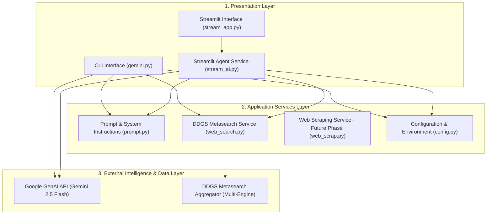
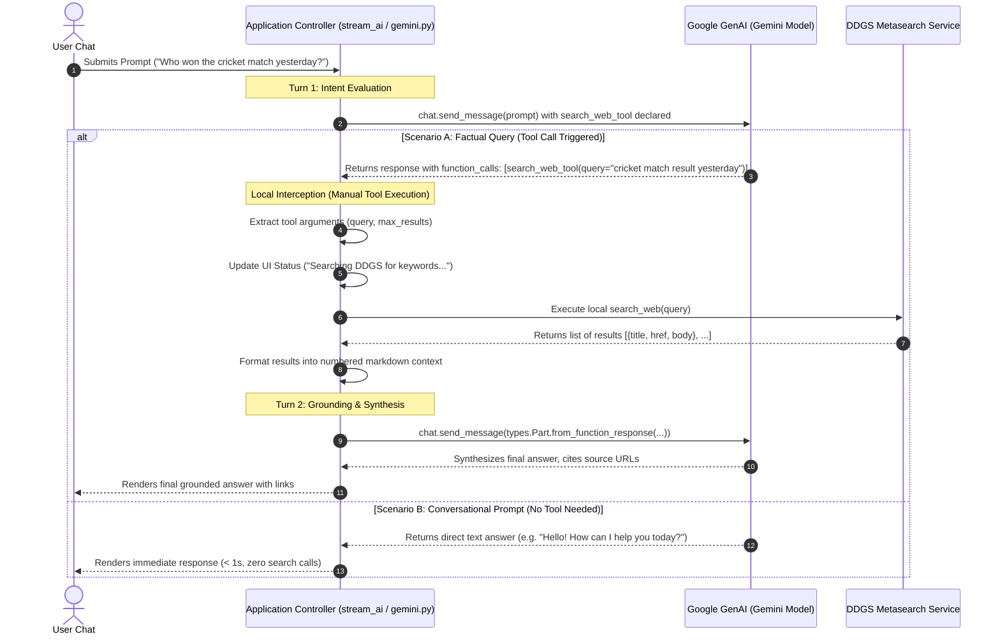

# Developer Implementation Plan: Manual Tool Calling for DDGS Metasearch

 **Document Target:** `.agents/implement_plan/manual-tool-calling-ddgs.md`  
 **Audience:** Human developers and engineers building the Web Agent project.  
 **Status:** Planning & Architectural Reference (Pre-Execution).  
 **Objective:** Transition from Phase 1 (Eager RAG Search) to Phase 1.5 (Autonomous LLM-Governed Tool Calling) using DDGS metasearch and Google GenAI SDK (`google-genai`).

---

## 1. Executive Summary & Educational Intent

In **Phase 1**, our system implemented a simple, hardcoded RAG pipeline: every time the user submitted a message, the application immediately executed a DDGS web search, injected the raw snippets into a text prompt template, and sent it to Gemini.

While functional as an initial prototype, this design has significant limitations:
- **Search Overuse:** Casual greetings (*"Hi"*, *"How are you?"*) or general questions (*"What is recursion?"*) unnecessarily trigger 2–3 second search engine queries.
- **Query Degradation:** Conversational user prompts (*"Could you please tell me who won the cricket match yesterday?"*) are passed verbatim to DDGS, confusing search engine ranking algorithms.
- **Zero Agent Autonomy:** The model has no control over *when* to search, *what* keywords to use, or *which* source URLs to inspect.

In **Phase 1.5**, we introduce **Autonomous Function / Tool Calling**. The LLM evaluates user intent, formulates concise search queries, and requests external tool execution only when real-time facts or external data are required.

### Why Manual Tool Execution over Automatic Function Calling (AFC)?
The Google GenAI SDK supports two methods for executing tools:
1. **Automatic Function Calling (AFC):** The SDK automatically detects tool requests, executes the Python function in the background, sends results back to the model, and completes all conversational turns internally.
2. **Manual Tool Execution (Our Pedagogical Choice):** Our Python application explicitly configures `automatic_function_calling=types.AutomaticFunctionCallingConfig(disable=True)`. We intercept `response.function_calls`, inspect the model's generated query, execute the local Python tool ourselves, and send a `FunctionResponse` back to the model in an explicit second turn.

```text
+----------------------------------------------------------------------------------------------------+
|                                WHY MANUAL TOOL EXECUTION?                                          |
+----------------------------------------------------------------------------------------------------+
| 1. Deep Conceptual Understanding: You see the exact JSON-RPC / tool-call protocol exchanged        |
|    between client and cloud LLM.                                                                   |
| 2. UI Transparency (Streamlit): You can intercept the tool call in real-time, extract the query,   |
|    and trigger live UI status boxes (e.g. st.status("Searching DDGS for 'python 3.13'...")).       |
| 3. Resilient Error Handling: You can gracefully catch search timeouts or network drops and format  |
|    a clean error message for the model without crashing the chat session.                          |
| 4. Seamless Stepping Stone to Phase 2: Building a manual loop makes adding a second tool           |
|    (such as full webpage scraping with Trafilatura) straightforward and transparent.               |
+----------------------------------------------------------------------------------------------------+
```

---

## 2. Architectural Comparison: Old vs. New

### 2.1 Old Architecture: Phase 1 Eager RAG Pipeline
In Phase 1, the retrieval step was completely decoupled from LLM reasoning. Search occurred unconditionally before the model ever saw the prompt.

```text
+===================================================================================+
|                          PHASE 1: EAGER SEARCH RAG PIPELINE                       |
+===================================================================================+

  [User Input Prompt]
         │
         ▼
  [search_web(user_prompt)]      <-- Always queries DDGS first (even for "Hello")
         │
         ▼
  [format_search_results()]      <-- Formats snippets into raw text block
         │
         ▼
  [augmented_prompt()]           <-- Fuses context string + user question into one prompt
         │
         ▼
  [client.interactions.create]   <-- Model reads injected text and answers
         │
         ▼
  [Final AI Response]
```

#### Drawbacks of Eager RAG:
1. **High Latency:** Every message pays a 1–3 second DDGS network penalty.
2. **Context Pollution:** Search snippets for non-search queries inject misleading noise into the prompt.
3. **Keyword Inefficiency:** Conversational fluff reduces DDGS search relevance.

---

### 2.2 New Architecture: Phase 1.5 Autonomous Agentic Tool Calling
In the new architecture, the LLM acts as the decision-maker (Router / Brain). It inspects the prompt and determines whether to answer directly from parametric memory or emit a tool call.

```text
+===================================================================================+
|                     PHASE 1.5: AUTONOMOUS MANUAL TOOL CALLING                     |
+===================================================================================+

                           [User Input Prompt]
                                    │
                                    ▼
                         [chat.send_message()]
                                    │
                                    ▼
                          [Gemini Model (Cloud)]
                                    │
                    ┌───────────────┴───────────────┐
                    │ Does it require live facts?   │
                    ▼                               ▼
            [NO: Direct Answer]           [YES: Tool Request]
                    │                               │
                    │                     FunctionCall(name, args)
                    │                               │
                    │                               ▼
                    │                   [Python App Interception]
                    │                   - Extracts search query
                    │                   - Updates Streamlit UI
                    │                               │
                    │                               ▼
                    │                     [search_web(query)]
                    │                     (Queries DDGS Metasearch)
                    │                               │
                    │                               ▼
                    │                   [FunctionResponse Part]
                    │                   (Packages titles, URLs, snippets)
                    │                               │
                    │                               ▼
                    │                     [chat.send_message()]
                    │                     (Sends tool output back to model)
                    │                               │
                    │                               ▼
                    │                     [Gemini Grounded Answer]
                    │                     (Cites verified source URLs)
                    └───────────────┬───────────────┘
                                    │
                                    ▼
                          [Final Response to User]
```

---

## 3. RAG Evolution & Retrieval Patterns

Understanding where our architecture sits in the broader landscape of Retrieval-Augmented Generation:

```text
+---------------------+---------------------------------------------------------------------------------+
| RAG Pattern Type    | Description & Relevance to Our Project                                          |
+---------------------+---------------------------------------------------------------------------------+
| 1. Naive / Eager    | Unconditional retrieval before generation.                                      |
|    RAG (Phase 1)    | Every prompt queries the external index. No model agency.                       |
|                     | Status: Replaced in this phase.                                                 |
+---------------------+---------------------------------------------------------------------------------+
| 2. Modular /        | The LLM autonomously decides *if* and *when* to retrieve. It formulates custom  |
|    Agentic RAG      | queries and passes them to specific external tools.                             |
|    (Phase 1.5)      | Status: Target of this implementation plan.                                     |
+---------------------+---------------------------------------------------------------------------------+
| 3. Deep Corrective  | The LLM searches, evaluates the relevance of snippets and source URLs, and if   |
|    RAG (Phase 2)    | shallow, triggers a second tool (web scraping) to inspect the full page content.|
|                     | Status: Next phase (Trafilatura integration).                                   |
+---------------------+---------------------------------------------------------------------------------+
```

---

## 4. End-to-End System Diagrams

### 4.1 System Component Architecture



---

### 4.2 Sequence Diagram: The Two-Turn Tool Call Dance

This diagram illustrates the exact messaging flow between the User, our Python Application Controller, the Gemini Model, and the DDGS Metasearch Engine.



---

### 4.3 Detailed Data Flow Pipeline

```text
[1. User Input Received]
         │
         ▼
[2. First Turn Message Dispatch]
         │  chat.send_message(user_prompt)
         ▼
[3. Model Reasoning & Intent Check]
         ├─ Branch A: No external facts needed -> Emits text response directly
         └─ Branch B: Needs real-time info -> Emits FunctionCall(name, args)
                  │
                  ▼
[4. Application Catches Tool Call]
         │  Intercepts response.function_calls[0]
         │  Extracts query (e.g. "latest python release") and max_results
         ▼
[5. Local DDGS Metasearch Execution]
         │  Invokes search_web(query, max_results)
         │  DDGS aggregates titles, href links, and content summaries
         ▼
[6. Context Serialization]
         │  format_search_results() produces numbered clean markdown:
         │  "[1] Title\nURL: https://...\nSummary: ..."
         ▼
[7. Second Turn Grounding Dispatch]
         │  chat.send_message(types.Part.from_function_response(name, response={"result": context}))
         ▼
[8. Model Synthesis & URL Citation]
         │  Gemini reads the search payload, reconciles facts, and formats answer
         ▼
[9. Delivery to Presentation Layer]
         │  CLI prints response; Streamlit displays answer and updates status indicator
```

---

## 5. Technical Mechanics: How the AI Decides

For autonomous tool calling to work reliably, the system depends on three coordinated elements:

### 5.1 Tool Function Signature & Docstrings
When registering `search_web_tool` with Gemini, the SDK parses the Python function signature:
- **Function Name (`search_web_tool`):** Identifies the tool in the model's catalog.
- **Type Annotations (`query: str`, `max_results: int = 3`):** Defines the argument types expected from the model.
- **Docstring Commentary:** Explains the tool's purpose to the model's internal function-calling router.

### 5.2 System Prompt Steering (`SYSTEM_PROMPT`)
The system prompt defines behavioral boundaries for the model:
1. **Search Trigger Policy:** Explicitly instructs the model when to call `search_web_tool` (real-time facts, current news, sports, documentation) and when to avoid it (general chat, logic, coding questions).
2. **Query Optimization:** Instructs the model to distill long, conversational user questions into concise search keywords.
3. **URL Citations:** Mandates that the model inspect the `URL:` fields returned in the tool response and cite them directly in its output.

### 5.3 URL Discovery & Link Selection
When DDGS returns results, each result contains three keys:
- `title`: The headline of the web page.
- `href`: The direct URL link.
- `body`: The descriptive text snippet.

By formatting these into structured markdown (`[1] Title\nURL: link\nSummary: body`), Gemini can read the links and evaluate which URLs represent the most credible primary sources.

---

## 6. Detailed Step-by-Step Implementation Blueprint

### 6.1 Responsibility Map of Affected Files

| Component / File Path | Phase 1 Role | Phase 1.5 Role |
| :--- | :--- | :--- |
| `backend/app/services/web_search.py` | Standalone DDGS runner | Exports `search_web_tool(query, max_results)` for Gemini tool declaration. |
| `backend/app/services/prompt.py` | Augmented prompt builder | Updated `SYSTEM_PROMPT` containing tool calling guidelines and citation rules. |
| `backend/app/services/gemini.py` | CLI loop with eager search | CLI interactive loop featuring manual tool interception. |
| `backend/streamlit/stream_ai.py` | Eager search generator | Chat session manager handling manual two-turn tool resolution. |
| `backend/streamlit/stream_app.py` | Chat UI with debug expander | UI with conditional status indicators based on tool execution. |

---

### 6.2 Implementation: `backend/app/services/web_search.py`

This file houses DDGS search execution, output serialization, and the tool wrapper function.

```python
# backend/app/services/web_search.py
# Metasearch service aggregating multi-engine results via DDGS

from typing import List, Dict, Any
from ddgs import DDGS

# Core DDGS metasearch function with timeout safeguards
def search_web(query: str, max_results: int = 4) -> List[Dict[str, Any]]:
    # Search via DDGS and return raw list of dicts with title, href, and body
    try:
        with DDGS(timeout=5) as ddgs:
            return list(ddgs.text(query, max_results=max_results))
    except Exception as exc:
        print(f"[Search Error] Failed to search for '{query}': {exc}")
        return []

# Context formatter converting search results into structured text
def format_search_results(results: List[Dict[str, Any]]) -> str:
    # Transforms list of result dictionaries into numbered markdown context
    if not results:
        return "No search results found."
    
    formatted_items = []
    for index, item in enumerate(results, start=1):
        title = item.get("title", "No Title")
        link = item.get("href", "")
        body = item.get("body", "No summary available.")
        formatted_items.append(
            f"[{index}] {title}\nURL: {link}\nSummary: {body}"
        )
    return "\n\n".join(formatted_items)

# Callable tool wrapper registered with Gemini
def search_web_tool(query: str, max_results: int = 3) -> str:
    # Metasearch tool for looking up real-time facts, news, and external documentation on the live web
    # Parameter query: Concise search keywords formulated to find relevant factual information
    # Parameter max_results: Number of web results to retrieve (default is 3)
    raw_results = search_web(query=query, max_results=max_results)
    return format_search_results(raw_results)

# Self-test block for standalone verification
if __name__ == "__main__":
    test_query = "FastAPI Python"
    print(search_web_tool(test_query, max_results=2))
```

---

### 6.3 Implementation: `backend/app/services/prompt.py`

In Phase 1, `augmented_prompt()` manually glued raw text together. In Phase 1.5, we rely on the `SYSTEM_PROMPT` to guide the model's autonomous tool calls.

```python
# backend/app/services/prompt.py
# System prompt and operational rules governing agent behavior and tool decisions

SYSTEM_PROMPT = """You are a fast, factual, and concise AI web agent.

Decision & Tool Guidelines:
1. When asked about recent events, current information, real-time facts, sports scores, or external documentation, call the `search_web_tool`.
2. Do NOT invoke search for basic conversational greetings, general logic, arithmetic, or programming theory that does not require external web data.
3. Formulate concise, high-signal keyword queries when invoking `search_web_tool` (e.g., convert "Can you tell me who won the cricket match yesterday?" to "cricket match result yesterday").
4. Inspect the URLs provided in the search results and cite them as markdown links when delivering factual answers.
5. If the search results do not contain the answer, explicitly state that the information was not found rather than guessing.
6. Keep final answers concise, direct, and well-structured (2 to 4 sentences or bullet points).
"""
```

---

### 6.4 Implementation: `backend/app/services/gemini.py` (CLI Interactive Loop)

The terminal client serves as our primary reference for the manual execution loop.

```python
# backend/app/services/gemini.py
# Terminal CLI orchestration using Google GenAI SDK with manual tool calling

from google import genai
from google.genai import types
from app.core.config import settings
from app.services.prompt import SYSTEM_PROMPT
from app.services.web_search import search_web_tool

# Initialize GenAI client with validated API key
client = genai.Client(api_key=settings.GEMINI_API_KEY)

# Configure chat session with tool declaration and manual execution enabled
config = types.GenerateContentConfig(
    system_instruction=SYSTEM_PROMPT,
    tools=[search_web_tool],
    automatic_function_calling=types.AutomaticFunctionCallingConfig(disable=True)
)

# Create multi-turn chat session
chat = client.chats.create(
    model="gemini-2.5-flash",
    config=config
)

print("=== Web Agent CLI (Manual Tool Calling Mode) ===")
print("Type 'exit' to quit.\n")

while True:
    user_prompt = input("User: ").strip()
    if user_prompt.lower() == "exit":
        break
    if not user_prompt:
        continue

    # Turn 1: Send user prompt to Gemini
    response = chat.send_message(user_prompt)

    # Turn 2: Check if Gemini decided to invoke a tool
    if response.function_calls:
        for tool_call in response.function_calls:
            print(f"\n[Tool Requested] Function: {tool_call.name}")
            print(f"[Tool Arguments] {tool_call.args}")

            # Match and execute local tool function
            if tool_call.name == "search_web_tool":
                search_query = tool_call.args.get("query", user_prompt)
                max_res = int(tool_call.args.get("max_results", 3))

                print(f"[Executing DDGS] Searching for: '{search_query}'...")
                tool_output = search_web_tool(query=search_query, max_results=max_res)

                # Send tool execution result back to Gemini
                response = chat.send_message(
                    types.Part.from_function_response(
                        name=tool_call.name,
                        response={"result": tool_output}
                    )
                )

    # Deliver final grounded response
    print("\nAI:", response.text)
    print("-" * 50)
```

---

### 6.5 Implementation: `backend/streamlit/stream_ai.py` (Streamlit Service Layer)

This module handles session instantiation and per-turn orchestration for the Streamlit UI.

```python
# backend/streamlit/stream_ai.py
# AI generation service for Streamlit UI with manual tool execution interception

import sys
from pathlib import Path
from google import genai
from google.genai import types

# Ensure backend root directory is in sys.path
BACKEND_DIR = Path(__file__).resolve().parent.parent
if str(BACKEND_DIR) not in sys.path:
    sys.path.insert(0, str(BACKEND_DIR))

from app.core.config import settings
from app.services.prompt import SYSTEM_PROMPT
from app.services.web_search import search_web_tool

# Initialize Google GenAI client
client = genai.Client(api_key=settings.GEMINI_API_KEY)

# Factory to instantiate a fresh agent chat session with tools attached
def create_agent_chat():
    config = types.GenerateContentConfig(
        system_instruction=SYSTEM_PROMPT,
        tools=[search_web_tool],
        automatic_function_calling=types.AutomaticFunctionCallingConfig(disable=True)
    )
    return client.chats.create(
        model="gemini-2.5-flash",
        config=config
    )

# Execution handler for a single user turn with manual tool resolution
def run_chat_turn(chat, user_prompt: str):
    # Turn 1: Dispatch user prompt to model
    response = chat.send_message(user_prompt)
    tool_executed = False
    tool_details = None

    # Turn 2: Inspect if Gemini decided to invoke a tool
    if response.function_calls:
        tool_call = response.function_calls[0]
        if tool_call.name == "search_web_tool":
            tool_executed = True
            query = tool_call.args.get("query", user_prompt)
            max_results = int(tool_call.args.get("max_results", 3))

            # Execute DDGS metasearch locally
            search_context = search_web_tool(query=query, max_results=max_results)

            tool_details = {
                "tool_name": tool_call.name,
                "query": query,
                "search_context": search_context
            }

            # Return tool response back to Gemini for final synthesis
            response = chat.send_message(
                types.Part.from_function_response(
                    name=tool_call.name,
                    response={"result": search_context}
                )
            )

    # Return final answer text, boolean indicator, and debug payload
    return response.text, tool_executed, tool_details
```

---

### 6.6 Implementation: `backend/streamlit/stream_app.py` (Streamlit Presentation)

The user interface displays dynamic status indicators and debug expanders when a search is executed.

```python
# backend/streamlit/stream_app.py
# Streamlit chat interface with dynamic tool execution status indicators

import sys
from pathlib import Path
import streamlit as st

# Configure system paths for module discovery
CURRENT_DIR = Path(__file__).resolve().parent
BACKEND_DIR = CURRENT_DIR.parent
for dir_path in (CURRENT_DIR, BACKEND_DIR):
    if str(dir_path) not in sys.path:
        sys.path.insert(0, str(dir_path))

from stream_ai import create_agent_chat, run_chat_turn

# Configure page metadata
st.set_page_config(page_title="Web Agent", page_icon="🌐", layout="wide")

st.title("🌐 Web Agent: Autonomous Search & Chat")
st.caption("Powered by Gemini Tool Calling and DDGS Metasearch")

# Sidebar controls
with st.sidebar:
    st.header("⚙️ Controls")
    if st.button("🗑️ Reset Conversation", use_container_width=True):
        st.session_state.messages = []
        st.session_state.chat = create_agent_chat()
        st.rerun()

# Initialize persistent chat session in session_state
if "chat" not in st.session_state:
    st.session_state.chat = create_agent_chat()

if "messages" not in st.session_state:
    st.session_state.messages = []

# Render chat history
for message in st.session_state.messages:
    with st.chat_message(message["role"]):
        st.markdown(message["content"])
        if message.get("debug_context"):
            with st.expander("🔍 View Retrieved Web Context"):
                st.text(message["debug_context"])

# Capture user query
if user_prompt := st.chat_input("Ask a question (e.g. 'What is the latest release of Python?')..."):
    # Render user prompt
    st.chat_message("user").markdown(user_prompt)
    st.session_state.messages.append({"role": "user", "content": user_prompt})

    # Assistant response generation
    with st.chat_message("assistant"):
        status_placeholder = st.empty()
        
        # Display progress status
        with status_placeholder.status("Thinking...", expanded=True) as status_box:
            ai_reply, tool_used, tool_info = run_chat_turn(
                chat=st.session_state.chat,
                user_prompt=user_prompt
            )
            
            if tool_used and tool_info:
                status_box.update(
                    label=f"Searched DDGS for: '{tool_info['query']}'",
                    state="complete",
                    expanded=False
                )
            else:
                status_box.update(
                    label="Answered directly (no search needed)",
                    state="complete",
                    expanded=False
                )

        # Render final AI response
        st.markdown(ai_reply)

        # Render debug expander if search was executed
        debug_text = tool_info["search_context"] if (tool_used and tool_info) else None
        if debug_text:
            with st.expander("🔍 View Retrieved Web Context"):
                st.text(debug_text)

        # Record assistant response in message history
        st.session_state.messages.append({
            "role": "assistant",
            "content": ai_reply,
            "debug_context": debug_text
        })
```

---

## 7. Conceptual Comparison: AFC vs. Manual Tool Execution

While we selected Manual Tool Execution for this project, here is how Automatic Function Calling (AFC) works conceptually for comparison:

```python
# Conceptual AFC Implementation (For Educational Comparison)
# In AFC, the SDK handles the execution loop internally

# 1. Provide the callable function directly in tools list
config = types.GenerateContentConfig(
    system_instruction=SYSTEM_PROMPT,
    tools=[search_web_tool]
    # By default, automatic_function_calling is ENABLED
)

chat = client.chats.create(model="gemini-2.5-flash", config=config)

# 2. In a single call, the SDK detects the tool call, invokes search_web_tool(),
#    sends results back to Gemini, and returns the final answer directly.
response = chat.send_message("What is the latest stable version of Python?")
print(response.text)
```

### Key Differences:
- **AFC** requires less boilerplate code, making it convenient for simple scripts.
- **Manual Tool Execution** provides full visibility into model-generated queries, allows step-by-step UI updates in Streamlit, and provides the architectural foundation for multi-step tool routing (e.g. searching then scraping).

---

## 8. Preparation for Phase 2: Web Scraping & URL Extraction

Once this manual tool calling foundation is established, transitioning to **Phase 2 (Deep Web Scraping)** requires no fundamental architectural rewrite. It simply introduces a **second tool**:

```text
                        [User Prompt]
                              │
                              ▼
                       [Gemini Router]
                       /             \
             Tool 1:  /               \  Tool 2:
     search_web_tool(query)     scrape_url_tool(url)
            │                               │
            ▼                               ▼
     [DDGS Metasearch]             [Trafilatura Extractor]
     (Finds relevant URLs)         (Fetches full page text)
```

### The Autonomous Multi-Tool Sequence:
1. **Search:** Gemini calls `search_web_tool(query="...")` to discover relevant URLs.
2. **Evaluation:** Gemini inspects the returned snippets. If a snippet is too short or incomplete, Gemini autonomously issues a second tool call: `scrape_url_tool(url="https://...")`.
3. **Deep Extraction:** Trafilatura fetches the clean article body and returns it to the model.
4. **Synthesis:** Gemini delivers an in-depth answer grounded in full-page text with direct citations.

---

## 9. Verification & Acceptance Criteria

To confirm Phase 1.5 is successfully implemented before beginning Phase 2:

| Test Case | User Input | Expected Behavior | Verification Check |
| :--- | :--- | :--- | :--- |
| **Test 1: Conversational Prompt** | `"Hi, how are you today?"` | Model answers directly. `tool_executed` is `False`. | Streamlit displays *"Answered directly (no search needed)"*. Response returns in < 1 second. |
| **Test 2: General Knowledge** | `"Explain what a binary search tree is in simple terms."` | Model answers from parametric memory. No search tool invoked. | Zero unnecessary DDGS requests executed. |
| **Test 3: Real-Time / Factual Query** | `"What is the latest release version of Python?"` | Model emits `search_web_tool(query="latest release version of Python")`. | Streamlit updates status to *"Searched DDGS for: '...' "*. Final answer cites source links from the results. |
| **Test 4: Source URL Grounding** | `"Who won the most recent cricket test match between India and Australia?"` | Model searches, cites specific source URLs from the search snippets in the final text. | Markdown links appear in the response text. |

---

## 10. Summary Checklist for Execution

When transitioning to code execution:
- [ ] Update `backend/app/services/web_search.py` with `search_web_tool()`.
- [ ] Update `backend/app/services/prompt.py` with the revised `SYSTEM_PROMPT`.
- [ ] Update `backend/app/services/gemini.py` with the manual tool execution loop.
- [ ] Update `backend/streamlit/stream_ai.py` with session persistence and manual turn resolution.
- [ ] Update `backend/streamlit/stream_app.py` with dynamic tool status indicators.
- [ ] Verify all test scenarios in the terminal CLI and Streamlit UI.
