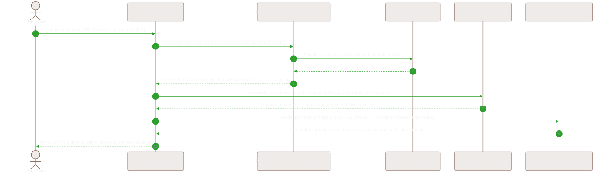

# Phase 1: Integrating DDGS Metasearch with Gemini Interactions API

A beginner's guide to building a grounded AI assistant using Python, DDGS (Dux Distributed Global Search), and the Google GenAI Interactions API.

 **What is DDGS?**

 **DDGS (Dux Distributed Global Search)** is an open-source metasearch library and web search tool that aggregates results from multiple search engines across the web without requiring API keys or user accounts.

---

## 1. System Architecture & Information Flow

### Figure 1.1: High-Level System Architecture
```text
+========================================================================+
|                        PRESENTATION LAYER                              |
|   CLI Terminal Interface / Streamlit UI / FastAPI Web Client           |
+========================================================================+
                                |  User Question
                                v
+========================================================================+
|                   APPLICATION ORCHESTRATION LAYER                      |
|                                                                        |
|  +------------------------+          +------------------------------+  |
|  | gemini.py              | -------> | prompt.py                    |  |
|  | (Session & Life Cycle) | <------- | (SYSTEM_PROMPT & Augmenter)  |  |
|  +------------------------+          +------------------------------+  |
|               |                                                        |
|               | Calls Search Service                                   |
|               v                                                        |
|  +------------------------------------------------------------------+  |
|  | web_search.py (Search Dispatcher & Snippet Serializer)           |  |
|  +------------------------------------------------------------------+  |
+========================================================================+
       |                                           |
       | Query Keywords                            | Grounded Prompt Payload
       v                                           v
+=============================+    +=====================================+
|  DDGS METASEARCH ENGINE     |    |   GOOGLE GENAI INTERACTIONS API     |
|  (Multi-Engine Aggregator)  |    |   (Gemini 3.5 Flash Lite Model)     |
+=============================+    +=====================================+
```

#### Architecture Explanation
The system separates responsibilities into three distinct layers. The **Presentation Layer** collects questions and renders final responses. The **Application Orchestration Layer** coordinates data processing: `web_search.py` controls search execution, `prompt.py` formats prompt structures, and `gemini.py` governs execution lifecycle and conversation memory. Finally, the **External Intelligence Layer** executes metasearch queries across public search engines via DDGS and generates factual, context-grounded responses using Gemini.

---

### Figure 1.2: End-to-End Data Flow
```text
[1. User Prompt] 
       │ 
       ▼
[2. Keyword Query] ───> [DDGS Metasearch Engine] ───> [Multi-Engine Search]
                                                              │
[3. Raw Results] <────────────────────────────────────────────┘
       │  (Title, URL Link, Snippet Body)
       ▼
[4. Context Serialization] ───> format_search_results() produces clean text
       │
       ▼
[5. Prompt Merging] ──────────> augmented_prompt() fuses question + context
       │
       ▼
[6. Model Evaluation] ────────> client.interactions.create() with SYSTEM_PROMPT
       │
       ▼
[7. Verified Output] ─────────> Returns concise grounded response with URLs
```

#### Flow Explanation
When a user asks a question, the application passes the prompt to the DDGS engine, querying multiple search engines simultaneously. DDGS returns a structured list containing titles, URLs, and short content snippets. The serializer transforms these results into a standardized text context block. This context is merged with the user question inside an augmented prompt template and dispatched alongside a governing `SYSTEM_PROMPT` to Gemini. The model synthesizes the search findings and returns a concise, source-cited answer.

---

### Figure 1.3: Interaction Sequence Diagram



---

## 2. Core Services Breakdown

### 2.1 Metasearch Service (`web_search.py`)
Fetches and structures external web data without requiring third-party API keys:

```python
from ddgs import DDGS

def search_web(query: str, max_results: int = 4) -> list[dict]:
    try:
        # DDGS context manager with timeout to prevent hanging on network stalls
        with DDGS(timeout=5) as ddgs:
            return list(ddgs.text(query, max_results=max_results))
    except Exception as exc:
        print(f"[Search Error] Failed to search for '{query}': {exc}")
        return []

def format_search_results(results: list[dict]) -> str:
    if not results:
        return "No search results found."
    formatted = []
    for i, item in enumerate(results, start=1):
        formatted.append(f"[{i}] {item.get('title')}\nURL: {item.get('href')}\nSummary: {item.get('body')}")
    return "\n\n".join(formatted)
```

Each result dictionary from `ddgs.text()` contains three core fields:
- `title`: The title headline of the search result.
- `href`: The destination webpage URL.
- `body`: A brief summary snippet extracted from the indexed page.

---

### 2.2 Prompt Service (`prompt.py`)
Separates behavioral instructions from dynamic user inputs:

```python
SYSTEM_PROMPT = """You are a fast, concise, and helpful AI web agent.
Rules:
1. Keep answers brief, direct, and factual (2-4 sentences or clear bullet points).
2. When web search results are provided, use them as your primary source of truth.
3. If search results do not contain the answer, state that clearly instead of guessing.
4. Always cite source links (URLs) when providing facts from the web.
"""

def augmented_prompt(user_question: str, search_context: str) -> str:
    """Combines search context and user query into a clean prompt string."""
    return f"Web Search Results:\n{search_context}\n\nUser Question:\n{user_question}\n"
```

---

### 2.3 Gemini Interactions Orchestration (`gemini.py`)
Manages execution, stateful interaction continuation, and client connection:

```python
from google import genai
from app.core.config import settings
from app.services.prompt import SYSTEM_PROMPT, augmented_prompt
from app.services.web_search import search_web, format_search_results

client = genai.Client(api_key=settings.GEMINI_API_KEY)
previous_id = None

while True:
    prompt = input("User: ").strip()
    if prompt.lower() == "exit": break

    # 1. Metasearch via DDGS & format text
    search_data = search_web(prompt, max_results=3)
    search_context = format_search_results(search_data)

    # 2. Build final prompt string by invoking function
    final_input = augmented_prompt(user_question=prompt, search_context=search_context)

    # 3. Call Interactions API with session continuity
    response = client.interactions.create(
        model="gemini-3.5-flash-lite",
        input=final_input,
        system_instruction=SYSTEM_PROMPT,
        previous_interaction_id=previous_id
    )
    previous_id = response.id
    print("AI:", response.output_text)
```

---

## 3. Common Pitfalls & Lessons Learned

| Symptom | Root Cause | Technical Explanation | Concrete Resolution |
| :--- | :--- | :--- | :--- |
| **Pydantic Validation Error (`input_type=function`)** | Passing function object instead of function return value. | Writing `input=augmented_prompt` passes the Python function reference `<function ...>` rather than calling it. Gemini requires `input` to be a string. | Call the function with arguments: `input=augmented_prompt(user_question=prompt, search_context=search_context)`. |
| **AI gives identical answers with or without search** | Passing unaugmented prompt to the model. | In `client.interactions.create(..., input=prompt)`, the raw user prompt was passed directly. Gemini never saw the search context. | Feed the serialized context into `augmented_prompt()` and pass the output to `input`. |
| **Terminal hangs indefinitely on query** | Unbounded HTTP requests in DDGS library. | Under slow network conditions or engine rate-limits, DDGS can wait up to 30 seconds for backend responses. | Supply an explicit timeout when instantiating the client: `with DDGS(timeout=5) as ddgs:`. |
| **Missing detailed facts from search** | Search snippets only provide 1–2 sentences. | Metasearch snippets contain high-level teasers, not full web articles. Deep questions require full webpage content. | Extract URLs and scrape full article text using tools like `trafilatura` or `crawl4ai`. |

---

## 4. Future Roadmap & Performance Enhancements

```text
Current Pipeline:
[User Prompt] -> [Always DDGS Search] -> [Wait 3s Full Generation] -> [Print Output]

Future Planned Pipeline:
[User Prompt] -> [URL in prompt?]
                    |-- Yes: Scrape Full Web Page (trafilatura)
                    |-- No:  Gemini Tool Calling (Searches only when necessary)
                        |
                        v
                 [Stream Tokens Word-by-Word] (Instant response)
```

### 4.1 Word-by-Word Streaming Response
* **Problem**: Waiting for the complete interaction response introduces a 2–4 second delay before any text displays.
* **Solution**: Use `client.models.generate_content_stream()` or `chat.send_message_stream()`.
* **Impact**: Perceived latency drops to ~300ms. Tokens display in real-time in the terminal, Streamlit (`st.write_stream`), or FastAPI SSE (`StreamingResponse`).

### 4.2 Autonomous Tool Calling (Function Calling)
* **Problem**: Searching DDGS on every prompt wastes seconds on conversational greetings (*"Hello"*, *"Thank you"*).
* **Solution**: Register `search_web` as a callable Gemini Tool. Gemini evaluates the prompt: greetings trigger direct responses, while factual queries autonomously trigger search tool invocations.

### 4.3 URL Extraction & Deep Web Scraping
* **Problem**: If a user inputs a URL (*"Summarize https://en.wikipedia.org/wiki/Scene"*), DDGS search cannot inspect the page contents.
* **Solution**:
  1. Extract URLs with regex:
     ```python
     import re
     url_match = re.search(r'https?://[^\s]+', user_prompt)
     ```
  2. Scrape clean page body using `trafilatura`:
     ```python
     import trafilatura
     full_text = trafilatura.extract(trafilatura.fetch_url(url))
     ```
  3. Ground Gemini with full article text for comprehensive and accurate answers.
