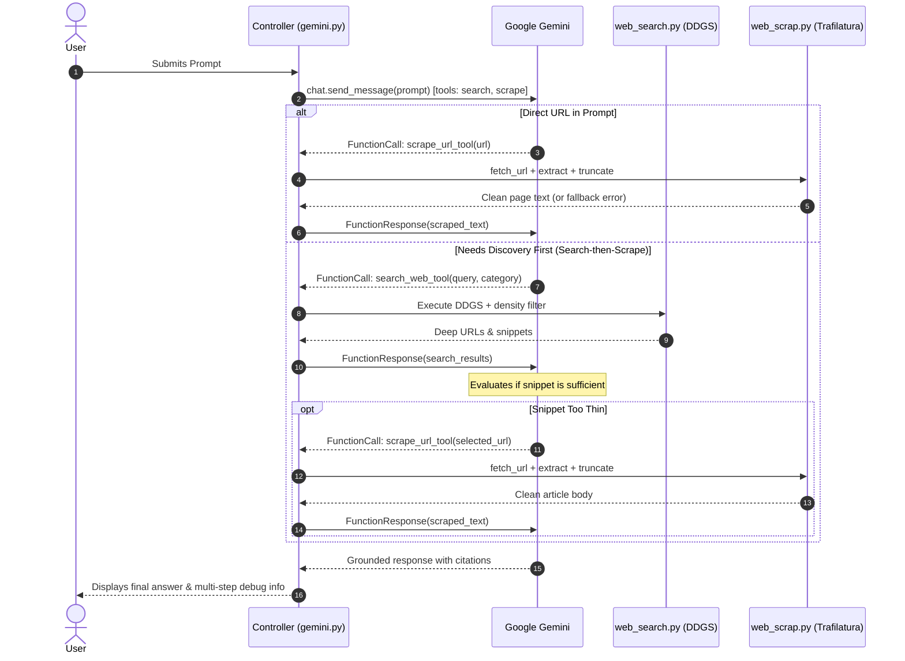

# Phase 2 Architecture & Implementation Plan: Deep Web Scraping with Trafilatura

**Status:** Planning & Architecture Reference (Pre-Execution)  
**Scope:** Phase 2 — On-Demand Full-Page Content Extraction using `trafilatura` *(Note: `crawl4ai` is intentionally excluded and reserved for a future JS/SPA phase)*

---

## 1. Executive Summary & Objective

In **Phase 1.5** and **Phase 1.8**, the Web Agent gained autonomous tool calling and dense, deep-link search results from DDGS. However, metasearch snippets still contain only 1–3 sentences. When a user pastes a direct URL or asks a complex technical question (e.g., installation steps, full documentation, or detailed news), snippets alone are insufficient.

**Phase 2 Objective:** Add a lightweight, domain-agnostic **Web Scraping Tool** (`scrape_url_tool`) powered by **Trafilatura** so the AI model can read full article text on demand.

```text
Phase 1.8 (Search-Only):
[User Prompt] ──> [DDGS Search] ──> [Short Snippets] ──> [Brief Answer]

Phase 2 (Search + Deep Scrape):
[User Prompt] ──> [DDGS Search] ──> [Evaluates Deep URLs] ──> [Trafilatura Scrape] ──> [In-Depth Answer]
              └──(Or Direct URL)────────────────────────────┘
```

### Why Trafilatura (and Why Not Crawl4AI Yet)?
* **Trafilatura** operates via fast HTTP fetching and static HTML DOM parsing in pure Python—ideal for news articles, blogs, Wikipedia, and technical documentation without headless browser overhead.
* **Crawl4AI** launches a Chromium browser to execute JavaScript. While useful for Single Page Applications (SPAs), it introduces heavy memory/CPU startup latency and is deferred to a dedicated future phase.

---

## 2. Core Architectural Principles

1. **Additive Composition (No Core Rewrite):**  
   `backend/app/services/gemini.py` already runs a multi-turn manual tool loop (`while response.function_calls and current_turn < max_tool_turns`). Phase 2 plugs `scrape_url_tool` directly beside `search_web_tool` inside `tools=[...]`.
2. **Selective Scraping (Latency Discipline):**  
   Scraping adds network and token overhead. The system prompt steers Gemini to scrape **only** when the user supplies a URL or when DDGS snippets lack enough detail to answer accurately.
3. **Fail-Safe & Token-Bounded Extraction:**  
   Websites frequently block bots (HTTP 403/Cloudflare) or publish massive pages. The scraper must validate URLs, cap extracted text length, and return informative fallback messages rather than raising unhandled exceptions.
4. **Full Multi-Step Observability:**  
   Because a single user turn can chain two tools (`search` $\rightarrow$ `scrape`), orchestration must record a **list of tool executions** rather than overwriting a single `tool_details` object.

---

## 3. Key Concepts & Important Code Snippets

### Concept 1: Two Execution Paths (Direct vs. Chained)
Depending on the user prompt, Gemini autonomously chooses between two workflows:
* **Path A — Direct URL Scraping:** User submits *"Summarize https://docs.python.org/3.13/whatsnew/3.13.html"*. Gemini skips `search_web_tool` and calls `scrape_url_tool(url)` immediately.
* **Path B — Search-then-Scrape (Multi-Hop RAG):** User asks *"How do I configure custom middleware in FastAPI?"*. Gemini runs `search_web_tool`, inspects the returned deep links, picks the authoritative URL, and invokes `scrape_url_tool(url)` in turn 2.

---

### Concept 2: Boilerplate Removal & Tool Contract (`web_scrap.py`)
Raw HTML contains menus, cookie banners, ads, and scripts. Trafilatura extracts only the main readable body and page metadata, while truncation protects Gemini's token budget and response speed.

```python
# Conceptual snippet for backend/app/services/web_scrap.py
from urllib.parse import urlparse
from trafilatura import fetch_url, extract, extract_metadata

def scrape_webpage(url: str, max_chars: int = 6000) -> str:
    # Validate scheme before making any outbound HTTP request
    parsed = urlparse(url)
    if parsed.scheme not in ("http", "https") or not parsed.netloc:
        return "Invalid URL provided. Only valid http/https links can be scraped."

    html = fetch_url(url)
    if not html:
        return "Unable to download webpage (site may block automated requests or require JavaScript)."

    # Extract clean main body without comment sections, favoring accuracy
    text = extract(html, url=url, include_comments=False, include_tables=True)
    if not text:
        return "No readable article content found on this page."

    metadata = extract_metadata(html, default_url=url)
    title = metadata.title if metadata and metadata.title else "Untitled Page"
    trimmed_text = text[:max_chars] + ("\n...[truncated]" if len(text) > max_chars else "")

    return f"Title: {title}\nURL: {url}\n\nContent:\n{trimmed_text}"

def scrape_url_tool(url: str) -> str:
    # Extracts full clean text content from a specific webpage URL
    # Parameter url: Full http or https URL of the article or documentation page to read
    return scrape_webpage(url=url)
```
*Why this matters:* Notice the strict `#` comments (no `"""` docstrings) matching project style, explicit URL scheme validation, character capping (`max_chars`), and non-crashing fallback messages so Gemini can recover gracefully using DDGS snippets.

---

### Concept 3: Dual-Tool Registration & History Tracking (`gemini.py`)
Registering both tools lets Gemini route requests dynamically. Tracking a list (`tool_history`) ensures the CLI and Streamlit UI can inspect every tool step executed in a turn.

```python
# Conceptual snippet for backend/app/services/gemini.py
config = types.GenerateContentConfig(
    system_instruction=SYSTEM_PROMPT,
    tools=[search_web_tool, scrape_url_tool],
    automatic_function_calling=types.AutomaticFunctionCallingConfig(disable=True),
    http_options=get_default_http_options(),
)
```

Inside `run_chat_turn()`, dispatch each requested function call and append its metadata to a list:

```python
# Conceptual routing inside the manual tool loop
tool_history = []
max_tool_turns = 4  # Allows Search -> Scrape -> Final Synthesis cleanly

# Inside `for tool_call in response.function_calls:`
if tool_call.name == "search_web_tool":
    # Execute DDGS search and append summary to tool_history
    ...
elif tool_call.name == "scrape_url_tool":
    target_url = tool_call.args.get("url", "")
    scraped_content = scrape_url_tool(url=target_url)
    tool_history.append({
        "tool_name": tool_call.name,
        "url": target_url,
        "content": scraped_content,
    })
    response_parts.append(
        types.Part.from_function_response(
            name=tool_call.name,
            response={"result": scraped_content},
        )
    )
```
*Why this matters:* Previously, a single `tool_details` variable held the last tool executed. Switching to `tool_history` prevents search context from being overwritten when Gemini chains `search_web_tool` followed by `scrape_url_tool`.

---

### Concept 4: Prompt Steering (`prompt.py`)
Without prompt boundaries, the model might either ignore `scrape_url_tool` or scrape too aggressively on trivial questions. `SYSTEM_PROMPT` should define clear rules:
* **Use `scrape_url_tool` when:** The user supplies a URL, or when `search_web_tool` snippets lack specific steps, code examples, or detailed facts.
* **Skip `scrape_url_tool` when:** DDGS snippets already answer the question completely, or when the URL is just a generic homepage.
* **Summary Length:** Keep normal answers concise (< 70 words), while allowing structured bullet summaries when summarizing a scraped article.

---

## 4. Architecture & Data Flow Diagrams

### 4.1 Updated System Component Architecture

```text
+=================================================================================+
|                              PRESENTATION LAYER                                 |
|  - Terminal CLI (backend/app/services/gemini.py)                                |
|  - Streamlit Debug UI (backend/streamlit/stream_app.py)                         |
+=================================================================================+
                                       │
                                       ▼
+=================================================================================+
|                       APPLICATION ORCHESTRATION LAYER                           |
|                                                                                 |
|  +---------------------------------------------------------------------------+  |
|  | gemini.py (Manual Multi-Turn Tool Loop) & prompt.py (Routing Rules)       |  |
|  +---------------------------------------------------------------------------+  |
|               │                                        │                        |
|               ▼ Tool 1                                 ▼ Tool 2                 |
|  +-------------------------------+        +----------------------------------+  |
|  | web_search.py                 |        | web_scrap.py (NEW - Phase 2)     |  |
|  | - search_web_tool()           |        | - scrape_url_tool(url)           |  |
|  | - DDGS text & news + filter   |        | - Trafilatura fetch & extract    |  |
|  +-------------------------------+        +----------------------------------+  |
+=================================================================================+
               │                                        │
               ▼                                        ▼
+-------------------------------+        +----------------------------------+
| DDGS Metasearch Engines       |        | Target Webpage (Static HTML)     |
+-------------------------------+        +----------------------------------+
```

### 4.2 Sequence Diagram: Direct Scrape vs. Chained Search-then-Scrape



---

## 5. Module Responsibility Map

| File Path | Phase 2 Responsibility | Key Change |
| :--- | :--- | :--- |
| `backend/app/services/web_scrap.py` | **Page Content Extraction** | Implement `scrape_webpage()` and `scrape_url_tool(url)` using `trafilatura` with URL validation and char limits. |
| `backend/app/services/prompt.py` | **Tool Selection Steering** | Add `scrape_url_tool` triggers, selective scraping rules, and fallback behavior to `SYSTEM_PROMPT`. |
| `backend/app/services/gemini.py` | **Dual-Tool Orchestration** | Register `scrape_url_tool`, handle its dispatch in `run_chat_turn()`, and track `tool_history` across turns. |
| `backend/streamlit/stream_app.py` | **Multi-Step UI Feedback** | Update `status_box` label and debug expander to show all search + scrape steps executed in a turn. |
| `backend/streamlit/stream_ai.py` | **Service Parity / Cleanup** | Either mirror `gemini.py` updates or retire duplicate logic since `stream_app.py` imports from `gemini.py`. |

---

## 6. Human Review Checkpoints (Anti-Vibe-Coding Gates)

Before marking Phase 2 complete, human reviewers must verify four concrete checkpoints:

| Checkpoint | What to Inspect | Acceptance Criteria |
| :--- | :--- | :--- |
| **CP-1: Scope & Dependency Boundary** | Imports in `backend/app/services/web_scrap.py` | Only `trafilatura` and standard library modules are used. **Zero** `crawl4ai` imports or browser processes. |
| **CP-2: Comment & Code Style Rule** | All modified Python files | All comments use single-line `#` syntax; no `"""` docstrings used as comments; no hardcoded website lists. |
| **CP-3: Safety & Token Guardrails** | `scrape_webpage()` implementation | Rejects non-HTTP(S) URLs, caps output length (`max_chars`), and handles `fetch_url() -> None` cleanly without raising exceptions. |
| **CP-4: Multi-Tool Observability** | CLI & Streamlit UI on a deep query | When Gemini searches then scrapes, UI status and debug expander display **both** the DDGS query and the scraped URL context. |
