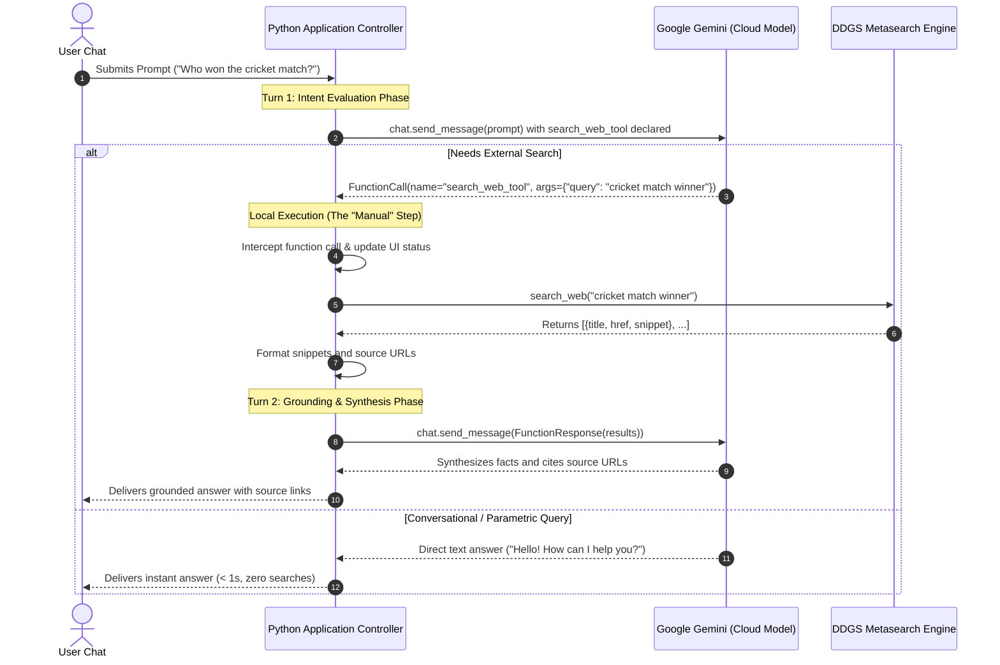

# From Eager RAG to Real AI Agents: A Beginner's Guide to RAG Patterns, Architectures, and Tool Calling

> **Target Audience:** Beginners, students, and engineers looking to understand how modern Retrieval-Augmented Generation (RAG) evolves into autonomous AI Agents.  
> **Repository Context:** Based on the architectural transition in the **Web Agent** project from Phase 1 (Eager RAG) to Phase 1.5 (Autonomous Tool Calling) and Phase 2 (Deep Web Scraping).

---

## Table of Contents
1. [Introduction: The Knowledge Problem in LLMs](#1-introduction-the-knowledge-problem-in-llms)
2. [RAG Pattern vs. RAG Architecture: Clearing the Confusion](#2-rag-pattern-vs-rag-architecture-clearing-the-confusion)
3. [Phase 1: The Eager RAG Pipeline (Naive Approach)](#3-phase-1-the-eager-rag-pipeline-naive-approach)
4. [Phase 1.5: On-Demand RAG and the Two-Turn Tool Dance](#4-phase-15-on-demand-rag-and-the-two-turn-tool-dance)
5. [Function Calling vs. Tool Calling: What is the Difference?](#5-function-calling-vs-tool-calling-what-is-the-difference)
6. [Why DDGS in Phase 1 Was Neither a Tool Call Nor a Function Call](#6-why-ddgs-in-phase-1-was-neither-a-tool-call-nor-a-function-call)
7. [Agentic AI vs. AI Agent: Is Phase 1.5 a "Real AI Agent"?](#7-agentic-ai-vs-ai-agent-is-phase-15-a-real-ai-agent)
8. [Side-by-Side Architectural Comparison](#8-side-by-side-architectural-comparison)
9. [Looking Ahead: Evolution to Phase 2 (Deep Web Scraping)](#9-looking-ahead-evolution-to-phase-2-deep-web-scraping)
10. [Summary & Quick Reference](#10-summary--quick-reference)

---

## 1. Introduction: The Knowledge Problem in LLMs

Large Language Models (LLMs) like Google Gemini are trained on massive public datasets. Their knowledge is frozen at a specific point in time:
- **Parametric Knowledge:** Information stored permanently inside the model's neural network weights. It excels at explaining concepts, writing algorithms, and reasoning, but cannot know what happened five minutes ago.
- **Non-Parametric Knowledge:** External data residing outside the model—such as live news, sports scores, private company files, or current web pages.

When an LLM is asked about real-time events without external data, it often **hallucinates** (generates confident-sounding but fabricated answers). 

**RAG (Retrieval-Augmented Generation)** solves this by retrieving fresh external data and feeding it to the model as context. However, **how** and **when** that retrieval happens determines whether your application is a simple script or an intelligent AI Agent.

---

## 2. RAG Pattern vs. RAG Architecture: Clearing the Confusion

A common source of confusion for beginners is mixing up **patterns** and **architectures**. They operate at completely different levels:

```text
+-------------------------------------------------------------------------------------------------+
|                                    THE EVERYDAY ANALOGY                                         |
+-------------------------------------------------------------------------------------------------+
| - The PATTERN is the STRATEGY (e.g. "Defensive Driving" or "Fuel-Efficient Route Planning").     |
|   It tells you WHEN and HOW decisions are made.                                                 |
| - The ARCHITECTURE is the VEHICLE (e.g. "Hybrid Engine, ABS Brakes, Transmission, Chassis").     |
|   It defines WHERE components sit and HOW wires and fluids flow between them.                   |
+-------------------------------------------------------------------------------------------------+
```

### 2.1 What is a RAG Pattern?
A **RAG Pattern** is an algorithmic strategy for retrieving and using information:
1. **Eager / Naive RAG Pattern (Phase 1):** Retrieve unconditionally on every prompt, before the model ever reads the question.
2. **On-Demand / Selective RAG Pattern (Phase 1.5):** Retrieve conditionally only when the model determines external data is required.
3. **Corrective RAG Pattern (CRAG):** Retrieve data, evaluate its quality, and if it is poor or incomplete, trigger an alternative search.
4. **Iterative / Multi-Hop RAG Pattern (Phase 2):** Retrieve an initial set of snippets, extract links, and retrieve deeper full-page content.

### 2.2 What is a RAG Architecture?
A **RAG Architecture** is the structural layout of the software system—its services, network calls, and control loops:
1. **Linear Pipeline Architecture:** A straight, one-way conveyor belt where data passes sequentially through retriever, formatter, and LLM.
2. **Router / Evaluator-Executor Architecture:** A two-turn feedback loop where the LLM evaluates intent, acts as a router, and communicates with external services.
3. **Microservices RAG Architecture:** A distributed enterprise system with separate microservices for embedding generation, vector databases, rerankers, and LLM inference.

---

## 3. Phase 1: The Eager RAG Pipeline (Naive Approach)

In Phase 1 of our project, we built a classic **Eager RAG** pipeline.

### How Phase 1 Worked (Step-by-Step):
```text
[User Prompt: "Hello!"]
          │
          ▼
[1. search_web("Hello!")]        <-- Unconditional DDGS Metasearch
          │
          ▼
[2. format_search_results()]     <-- Formats snippets into raw text
          │
          ▼
[3. augmented_prompt()]          <-- Injects search text into prompt template
          │
          ▼
[4. Gemini Model Evaluation]     <-- Gemini reads injected context + question
          │
          ▼
[5. AI Response Output]
```

### Why Phase 1 Had Major Limitations:
1. **Unnecessary Latency:** When the user typed *"Hello"*, the application spent 2 seconds querying DDGS for the word *"Hello"*, getting irrelevant snippets, and slowing down the response.
2. **Prompt Pollution:** The model was forced to read irrelevant search snippets for basic greetings and general coding logic.
3. **Poor Query Formatting:** Users type full conversational sentences:  
   *"Can you please tell me who won the cricket match yesterday?"*  
   In Phase 1, that entire sentence was passed directly to the search engine. Search engines perform far better with clean keywords: `cricket match result yesterday`.
4. **Zero Model Agency:** The LLM was a passive reader. It had no power to decide whether to search or what to search.

---

## 4. Phase 1.5: On-Demand RAG and the Two-Turn Tool Dance

In Phase 1.5, we transition to **On-Demand RAG** using **Autonomous Tool Calling**.

### The Core Principle: The LLM Does Not Browse the Web
Gemini runs in the cloud. It has no network socket, no web browser, and cannot execute Python.  
- **Gemini is the "Brain"** (language understanding, reasoning, intent classification).  
- **Our Python Application is the "Hands and Eyes"** (executes local functions, calls DDGS, reads files).

### The Two-Turn Tool Loop



### Step-by-Step Breakdown:
1. **Turn 1 (Decision):** The Python app forwards the user prompt to Gemini with `search_web_tool` declared in the configuration.
2. **Branching:**
   - If the user said *"Hi"*, Gemini responds with text directly. Zero tools are called.
   - If the user asked about live events, Gemini halts its generation and emits a structured request:  
     `FunctionCall(name='search_web_tool', args={'query': 'cricket match winner'})`
3. **Execution:** Our Python code catches this request, extracts the keyword query, executes `search_web()` locally via DDGS, and formats the output into clean text containing titles, snippets, and URLs.
4. **Turn 2 (Grounding):** Our Python code sends the search results back to the model wrapped in `types.Part.from_function_response(...)`.
5. **Synthesis:** Gemini reads the verified facts, extracts the relevant source URLs, and delivers a concise, hallucination-free answer.

---

## 5. Function Calling vs. Tool Calling: What is the Difference?

These two terms are often used interchangeably, but understanding their technical difference is key to mastering AI engineering:

```text
+-----------------------+---------------------------------------+---------------------------------------+
| Feature               | Function Calling                      | Tool Calling                          |
+-----------------------+---------------------------------------+---------------------------------------+
| Level of Concept      | Low-level protocol and message format | High-level system capability          |
| What it Represents    | The JSON-RPC wire contract            | An external instrument given to AI    |
| Primary Mechanism     | Schema definition, argument parsing,  | Giving the model eyes, hands, or      |
|                       | and return value serialization        | access to third-party services        |
| Everyday Analogy      | The USB electrical cable & protocol   | The webcam or printer plugged into it |
+-----------------------+---------------------------------------+---------------------------------------+
```

### Why Both Terms Appear in Code:
In the Google GenAI SDK (`google-genai`):
- You register capabilities under the `tools` configuration list:
  ```python
  # Python code snippet
  config = types.GenerateContentConfig(tools=[search_web_tool])
  ```
- When the model decides to use that tool, the SDK delivers it inside the `function_calls` attribute:
  ```python
  # Python code snippet
  if response.function_calls:
      call = response.function_calls[0]
  ```
- **Conclusion:** **Tool Calling** is what the AI is doing conceptually (using an external tool). **Function Calling** is the technical protocol it uses to execute that tool.

### Automatic Function Calling (AFC) vs. Manual Tool Execution
The SDK supports two execution modes:
- **Automatic Function Calling (AFC):** The SDK detects the tool request, runs your Python function automatically behind the scenes, and returns the final answer in one line. While convenient, it acts like a black box.
- **Manual Tool Execution (Our Pedagogical Choice):** We disable AFC (`disable=True`). Our application intercepts the tool call, inspects the query, displays real-time progress indicators in Streamlit (`st.status`), and manually dispatches the second turn. This provides complete visibility and robust error handling.

---

## 6. Why DDGS in Phase 1 Was Neither a Tool Call Nor a Function Call

Beginners often ask:  
*"In Phase 1, DDGS searched the web, which is an external capability. Why wasn't that tool calling?"*

### The Blindfold Analogy
Imagine a human researcher sitting in a room with a blindfold on:
- **Phase 1 (Hardcoded Pipeline):** An assistant walks in, looks up a topic on Google, prints out the webpage, removes the researcher's blindfold, places the paper in front of them, and says: *"Read this paper and answer the question."*  
  The researcher did **not** use a search tool. The researcher had no idea a search engine even existed. The assistant did all the work before entering the room.
- **Phase 1.5 (Autonomous Tool Calling):** The researcher sits at a desk with a computer. The researcher is handed a question, thinks: *"I don't know this fact"*, turns to the computer, types a search query, reads the results on screen, and writes the answer.  
  Here, the researcher **actively chose to use the tool**.

In Phase 1, Gemini was the blindfolded researcher. Our Python code executed `search_web()` as an ordinary Python function, pasted the text into a string, and handed it to Gemini. Gemini never received a tool declaration and never issued a tool call.

---

## 7. Agentic AI vs. AI Agent: Is Phase 1.5 a "Real AI Agent"?

To answer whether our project is a "real" agent, we must separate the adjective (*agentic*) from the noun (*agent*):

### 7.1 What is "Agentic AI"?
**Agentic AI** refers to a **set of behaviors and characteristics**. An AI workflow is described as *agentic* when it exhibits:
- **Autonomy:** Making decisions rather than following hardcoded paths.
- **Goal-Directedness:** Formulating sub-actions to achieve a stated objective.
- **Reflection & Self-Correction:** Evaluating outputs and revising plans.

### 7.2 What is an "AI Agent"?
An **AI Agent** is an autonomous software system comprised of five essential components:
1. **The Brain (LLM):** Core reasoning and decision-making engine.
2. **Perception (Input):** Receiving user requests and environmental signals.
3. **Tools / Actuators (Actions):** Instruments to interact with the world (search, scrapers, APIs).
4. **Memory:** Short-term context (chat session history) and long-term memory (databases).
5. **The Feedback Loop:** Observing the outcome of an action and deciding what to do next.

```text
               +-------------------------------------------+
               |                  1. BRAIN                 |
               |        (Gemini Reasoning Engine)          |
               +---------------------┬---------------------+
                                     │
           +-------------------------┼-------------------------+
           ▼                         ▼                         ▼
  +------------------+     +------------------+      +------------------+
  |   2. PERCEPTION  |     |     3. TOOLS     |      |    4. MEMORY     |
  |  (User Question) |     |  (DDGS Search)   |      |  (Session State) |
  +------------------+     +---------┬--------+      +------------------+
                                     │
                                     ▼
                      +-----------------------------+
                      |      5. FEEDBACK LOOP       |
                      | (Evaluate snippets and cite)|
                      +-----------------------------+
```

### 7.3 The Verdict: Where Does Our Project Stand?

```text
+-------------------+---------------------------+-----------------------------------------------+
| Project Phase     | System Classification     | Capabilities & Level of Autonomy             |
+-------------------+---------------------------+-----------------------------------------------+
| Phase 1           | Static RAG Script         | Zero autonomy. Rigid, linear pipeline.        |
| Phase 1.5         | First-Order Router Agent  | Autonomous decision-making, keyword query      |
| (Current Target)  | (Single-Turn Tool Agent)  | formulation, and factual URL grounding.       |
| Phase 2           | Full Multi-Step Research  | Multi-tool chaining: Search -> Inspect URLs   |
| (Next Milestone)  | Agent                     | -> Scrape full page via Trafilatura -> Answer.|
+-------------------+---------------------------+-----------------------------------------------+
```

- **Phase 1.5 is a genuine, foundational AI Agent.** It perceives user intent, consults its internal memory, decides whether to deploy an external tool, executes the tool, and grounds its answer on the results.
- **It is not yet a complex multi-step agent** because it performs a 1-step tool loop (single search turn).
- In **Phase 2**, it evolves into a **Full Deep Research Agent** capable of chaining multiple tools autonomously.

---

## 8. Side-by-Side Architectural Comparison

```text
+-----------------------+---------------------------------------+---------------------------------------+
| Evaluation Vector     | Phase 1: Eager RAG Pipeline           | Phase 1.5: Autonomous Tool Calling    |
+-----------------------+---------------------------------------+---------------------------------------+
| RAG Pattern           | Eager / Naive RAG                     | On-Demand / Selective RAG             |
| Architectural Style   | Linear Unidirectional Pipeline        | Two-Turn Evaluator-Executor Loop      |
| Search Trigger        | Always runs (100% of messages)        | Runs only when factual data is needed |
| Latency on Greetings  | High (2–3s DDGS search delay)         | Ultra-fast (< 1s, direct response)    |
| Search Query Quality  | Raw user text (noisy, conversational) | Optimized search keywords by LLM      |
| Streamlit UI Status   | Hardcoded spinner on every turn       | Dynamic status box only when searching|
| URL Source Citations  | Passive (model reads injected text)   | Active (model inspects returned URLs) |
| System Flexibility    | Inflexible (cannot chain other tools) | Highly modular (foundation for scrap) |
+-----------------------+---------------------------------------+---------------------------------------+
```

---

## 9. Looking Ahead: Evolution to Phase 2 (Deep Web Scraping)

The primary reason we adopt manual tool calling now is that it provides the exact architectural scaffolding required for **Phase 2: Deep Web Content Extraction**.

### The Problem with Snippets Alone:
Search engine snippets are typically only 1–2 sentences long. If a user asks:  
*"Summarize the installation and configuration of Trafilatura in Python,"*  
search snippets cannot provide the complete instructions.

### The Phase 2 Multi-Tool Vision:
By establishing the tool calling loop in Phase 1.5, adding web scraping in Phase 2 simply means registering a **second tool**:

```text
                                [User Prompt]
                                      │
                                      ▼
                                [Gemini Brain]
                                /            \
                      Tool 1:  /              \  Tool 2:
              search_web_tool()                scrape_url_tool()
                     │                                │
                     ▼                                ▼
              [DDGS Metasearch]             [Trafilatura Scraper]
              (Discovers URLs)              (Extracts Full Web Page)
```

### The Autonomous Multi-Tool Chain:
1. **Turn 1 (Search):** Gemini realizes it needs live documentation and invokes `search_web_tool(query="Trafilatura Python documentation")`.
2. **Turn 2 (Evaluation):** Gemini inspects the returned snippets and source URLs. It sees `https://trafilatura.readthedocs.io/` and decides the snippet is too brief.
3. **Turn 3 (Deep Scraping):** Gemini invokes `scrape_url_tool(url="https://trafilatura.readthedocs.io/")`.
4. **Turn 4 (Synthesis):** Trafilatura extracts the full, clean article text, sends it to Gemini, and Gemini produces an in-depth, verified tutorial citing the official source.

---

## 10. Summary & Quick Reference

1. **RAG Pattern vs. RAG Architecture:** Pattern is the **strategy** (Eager vs. On-Demand). Architecture is the **structure** (Linear Pipeline vs. Two-Turn Feedback Loop).
2. **Phase 1 vs. Phase 1.5:** Phase 1 was an **Eager RAG script** (always searched first). Phase 1.5 is an **On-Demand RAG Agent** (the AI decides when and what to search).
3. **Tool Calling vs. Function Calling:** Tool Calling is the **capability** (giving the model an instrument). Function Calling is the **protocol** (the JSON exchange mechanism).
4. **Why Phase 1 Was Not Tool Calling:** Gemini was completely unaware that DDGS existed; the Python code executed the search independently and pasted text into the prompt.
5. **Real AI Agent Status:** Phase 1.5 is a **First-Order Router Agent** with genuine autonomy over search decisions, setting the stage for Phase 2's **Deep Autonomous Research Agent**.
